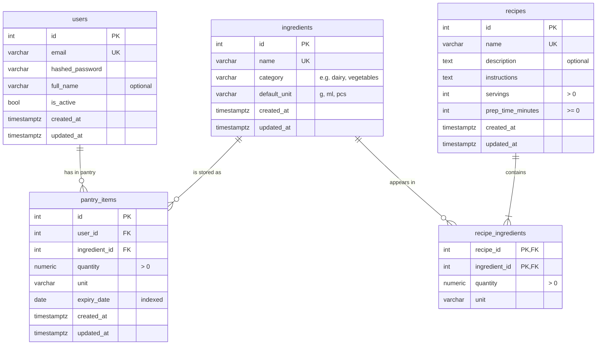

# ERD – ZeroRisipa

Database schema (ZER-2). GitHub and VS Code (with the *Markdown Preview Mermaid Support* extension) render the diagram directly.

## Decisions

- **`ingredients` is a shared catalogue.** Pantries and recipes use the same ingredients, so the optimization algorithm can match what is expiring directly against what recipes need.
- **`pantry_items.expiry_date` is indexed**, for the "what expires in the next N days" query.
- **Deletes:** deleting a user also deletes their pantry; deleting a recipe also deletes its ingredient links. An ingredient that is in use somewhere cannot be deleted (`RESTRICT`).
- **Units:** each row has its own unit (`unit`); `default_unit` is only the suggestion for forms. Converting between units (g ↔ kg) is left to the algorithm task.
- **`recipe_ingredients`** has a composite primary key `(recipe_id, ingredient_id)`, so an ingredient appears only once per recipe.
