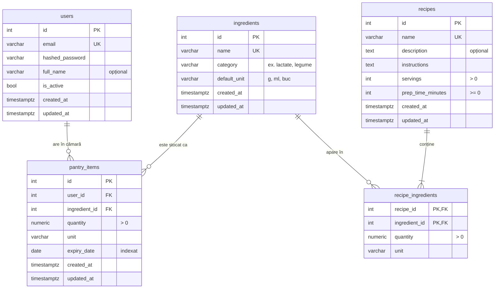

# Diagrama ERD – ZeroRisipa

Schema bazei de date (ZER-2). GitHub și VS Code (cu extensia *Markdown Preview Mermaid Support*) afișează diagrama direct.

## Decizii

- **`ingredients` e un catalog comun.** Cămara și rețetele folosesc aceleași ingrediente, așa că algoritmul de optimizare poate potrivi direct ce expiră cu ce cer rețetele.
- **`pantry_items.expiry_date` are index**, pentru interogarea „ce expiră în următoarele N zile”.
- **Ștergeri:** dacă se șterge un utilizator, i se șterge și cămara; dacă se șterge o rețetă, i se șterg ingredientele asociate. Un ingredient folosit undeva nu poate fi șters (`RESTRICT`).
- **Unități:** fiecare rând are propria unitate (`unit`); `default_unit` e doar sugestia pentru formulare. Conversia între unități (g ↔ kg) rămâne pentru taskul algoritmului.
- **`recipe_ingredients`** are cheie primară compusă `(recipe_id, ingredient_id)`, deci un ingredient apare o singură dată într-o rețetă.
