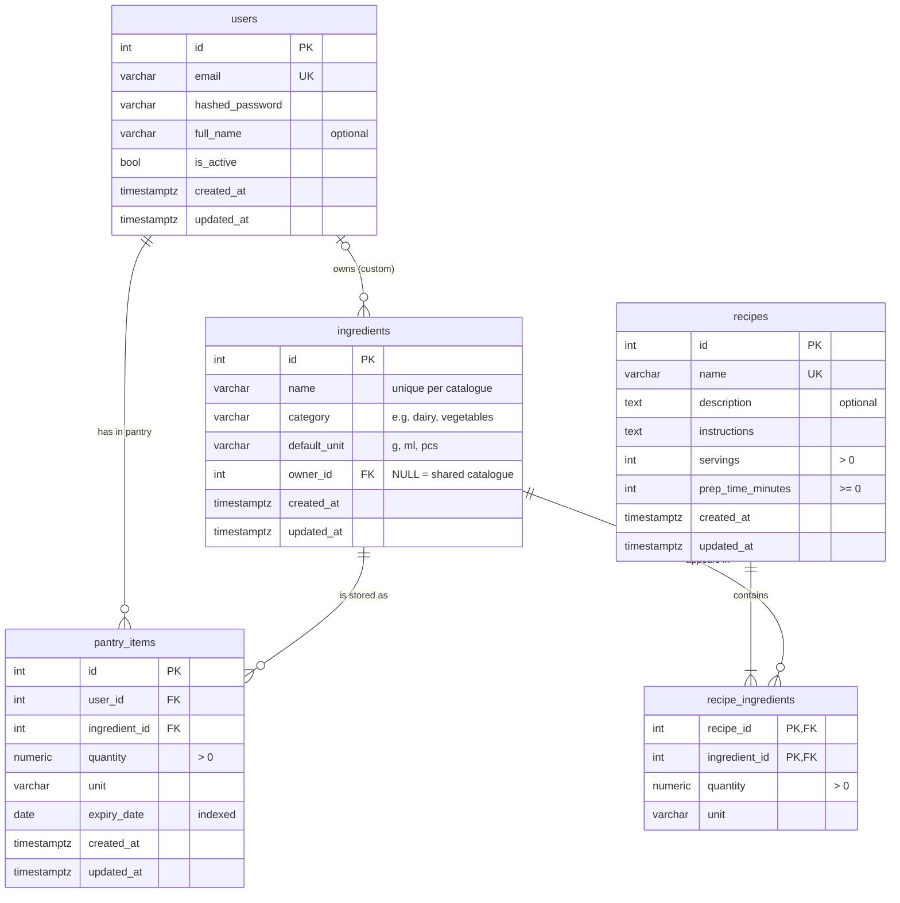

# ERD – ZeroRisipa

Database schema (ZER-2). GitHub and VS Code (with the *Markdown Preview Mermaid Support* extension) render the diagram directly.

## Decisions

- **`ingredients` is a shared catalogue plus per-user additions.** Rows with `owner_id` NULL are the shared catalogue (loaded by the seed); rows with `owner_id` set are a user's own ingredients, visible only to them. Pantries and recipes use the same table, so the optimization algorithm can match what is expiring directly against what recipes need. Recipes only use the shared catalogue.
- **Ingredient names** are stored lowercase and are unique within the shared catalogue and within each user's catalogue (two partial unique indexes). A user can't add a name that already exists in the shared catalogue.
- **`pantry_items.expiry_date` is indexed**, for the "what expires in the next N days" query.
- **Deletes:** deleting a user also deletes their pantry and their own ingredients; deleting a recipe also deletes its ingredient links. An ingredient that is in use somewhere cannot be deleted (`RESTRICT`).
- **Units:** each row has its own unit (`unit`); `default_unit` is only the suggestion for forms. Converting between units (g ↔ kg) is left to the algorithm task.
- **`recipe_ingredients`** has a composite primary key `(recipe_id, ingredient_id)`, so an ingredient appears only once per recipe.
